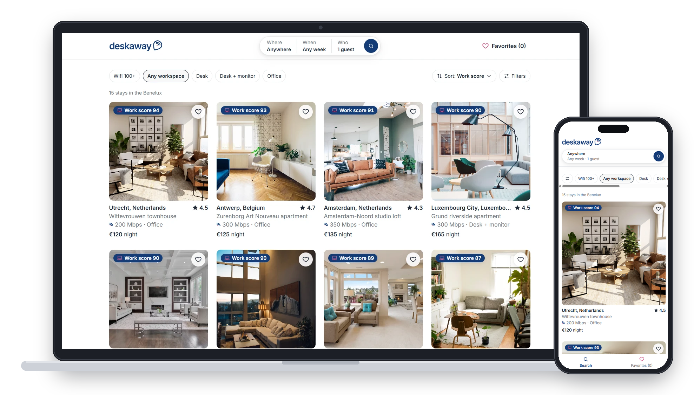
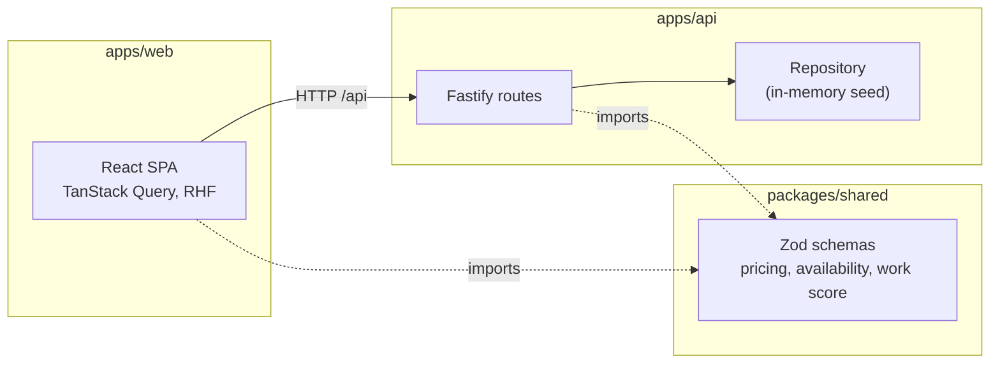

# Deskaway

Book stays in the Benelux where you can actually work.

- Live: https://deskaway-h0fv.onrender.com/ (free tier: the first load after a pause can take up to a minute)
- Recording: https://www.loom.com/share/9c5fbfe213f4404e8d232eb83ec410fc



## Quick start

Requires Node 24 (see `.nvmrc`).

```sh
npm install
npm run dev
```

- Web (Vite): http://localhost:5173
- API (Fastify): http://localhost:3000

In dev, Vite proxies `/api` to the API, so the browser only talks to one origin.

Production build:

```sh
npm run build
npm start
```

`npm start` serves the API and the built web app on port 3000 (or `PORT`). No env var is needed: `NODE_ENV=production` is inlined into the API bundle.

## Scripts

| Script | What it does |
|---|---|
| `npm run dev` | Starts API (`tsx watch`) and web (Vite) together |
| `npm run lint` | ESLint, then Prettier check |
| `npm run format` | Prettier write |
| `npm run typecheck` | `tsc --noEmit` for the root and every workspace |
| `npm test` | Vitest, all three projects (web, api, shared) |
| `npm run build` | Builds web (Vite), then API (esbuild) |
| `npm start` | Runs the production API bundle, which also serves the web app |

## Product scope

**Who it is for.** Remote workers who want a 1 to 4 week stay in the Benelux and need to work there. Every feature answers one question: "Can I work here?"

**Work score.** Each stay gets a score from 0 to 100. It is the default sort.

| Part | Weight | How it is scored |
|---|---|---|
| Wifi download | 40% | Linear from 0 to 100 Mbps, capped |
| Workspace type | 25% | office 25, desk_monitor 20, desk 15 |
| Noise | 20% | From the average review rating; no reviews = half points |
| Coworking distance | 15% | Linear from 0 to 5 km; none nearby = 0 |

The weights are my judgement, not data-driven.

**Availability.** One stay is one bookable unit (apartment or studio). No hotels, no room types. Availability is a date range plus a number of guests.

- Dates are ISO `YYYY-MM-DD`. Check-out is exclusive: 1-5 Nov and 5-8 Nov do not overlap.
- Check-in cannot be in the past. "Today" is the date in Europe/Brussels.
- Each stay has a minimum number of nights (default 3) and a maximum number of guests.
- Price = nights x nightly rate + cleaning fee + city tax. Money is integer euro cents.

## Architecture



- Business rules live only in `@deskaway/shared`, as pure functions. Both apps import them. The API decides; the web app displays.
- The server never trusts client prices. `POST /api/bookings` re-quotes.
- `@deskaway/shared` ships TypeScript source with no build step. Vite, tsx, esbuild and Vitest compile it.
- Data is seed data loaded into memory at startup, behind a repository interface. Seed bookings are relative to today, so the demo never shows old dates.

**Production serving.** One Fastify process serves both the API and the built web app, with an SPA fallback to `index.html` for non-API GET routes. One process, one port, no CORS. It runs as a single Render web service, because in-memory data needs one long-running process.

**Folder map**

```
apps/
  api/           Fastify server
    scripts/     esbuild production build
    src/routes/  stays, reviews, bookings, health
    src/repo/    repository interface + in-memory implementation
    src/seed/    seed data
    api.http     manual API checks
  web/           React app
    src/app/         app shell and routing
    src/components/  design tokens and base components
    src/features/    search, stay, booking, checkout, reviews, favorites, styleguide
    src/test/        MSW server, fixtures, render helper
packages/
  shared/        Zod schemas and domain logic (TS source)
docs/
  wireframes.html  screen layouts (desktop + mobile)
  prompts.md       full example prompts
  screenshot.png   README image
```

## API

| Method + path | Success | Errors |
|---|---|---|
| GET /api/stays?city&checkIn&checkOut&guests&minWifi&workspace&sort&page | 200 { items, total, page }; items include workScore, and a quote when dates are given | 400 |
| GET /api/stays/:id | 200 stay + workScore + review summary | 404 |
| GET /api/stays/:id/quote?checkIn&checkOut&guests | 200 Quote (available false + reason when not bookable, incl. DATES_TAKEN) | 400, 404, 422 check-in in the past |
| GET /api/stays/:id/availability?from&to | 200 { blocked: string[] } (taken nights) | 400, 404 |
| GET /api/stays/:id/reviews?sort=recent\|rating | 200 Review[] | 404 |
| POST /api/stays/:id/reviews | 201 Review | 400, 404, 422 moderation, 429 |
| POST /api/bookings | 201 Booking (server re-quotes) | 400, 404, 409 dates taken, 422 rule broken, 429 |
| GET /api/bookings/:id | 200 Booking | 404 |

409 = conflict with current state (someone else booked). 422 = the request breaks a rule (too few nights).

All errors use one shape: `{ error: { code, message, details? } }`.

| Status | Codes |
|---|---|
| 400 | VALIDATION_ERROR (details: the Zod issues) |
| 404 | NOT_FOUND |
| 409 | DATES_TAKEN |
| 422 | CHECK_IN_IN_PAST, INVALID_DATES, MIN_NIGHTS, MAX_GUESTS, REVIEW_REJECTED |
| 429 | RATE_LIMITED (POST routes: 10 per minute per IP) |
| 500 | INTERNAL_ERROR, SIMULATED_FAILURE (dev only) |

Dev only: add `?_delay=ms` (max 10 s) or `?_fail=1` to any GET to see loading and error states. Every response has an `x-request-id` header, and the same id is in every log line for that request.

## Testing

One root Vitest config with three projects. Run all with `npm test`.

| Layer | Covers | Why |
|---|---|---|
| shared | Pricing, availability, blocked nights, work score, schemas, today | The business rules live here, so they get the most tests. Runs in Europe/Amsterdam time so the clock-change test fails on buggy code in CI (UTC). |
| api | Routes via Fastify, seed data consistency | Checks the contract, status codes and error codes. Covers the booking path end to end on the server, including 409 on taken dates. |
| web | Components with Testing Library, API mocked with MSW, one axe check | Tests user flows: search (incl. axe) and checkout (incl. the 409 case). |

There are no Playwright e2e tests. The booking path is covered by API integration tests and component tests.

## Non-functional requirements

- **Responsive:** mobile first, checked at 375 px and on desktop. On mobile a tab bar replaces the header link, and the stay page has a fixed booking bar.
- **Async states:** every screen has a loading skeleton, an empty state and an error state with retry. Add `?_delay=2000` or `?_fail=1` to a GET in dev to see them.
- **Accessibility:** semantic HTML and labelled inputs, focus moves to the page heading on navigation and to errors when they appear, a keyboard-usable calendar, and status messages for screen readers. Checked by `eslint-plugin-jsx-a11y` on every lint run and an axe test in CI.
- **Observability:** pino logs with a request ID on every line. The same ID is returned in the `x-request-id` header and shown in error messages, so a user's error can be traced to the log. Request bodies are never logged, so names and emails stay out of the logs.

## CI/CD and releases

**Pull requests** (`.github/workflows/ci.yml`), on every PR to `main`:

- PR title must be a conventional commit.
- `npm ci`, lint, typecheck, test, build.
- The build output is uploaded as an artifact. The run fails if it is missing.
- The workflow token is read-only.

**Releases** (`.github/workflows/release.yml`), on every push to `main`:

1. release-please opens or updates a release PR with the version bump and `CHANGELOG.md`.
2. Merging that PR creates a tag and a GitHub release.
3. The publish job builds the app, zips `apps/web/dist` and `apps/api/dist`, and attaches the zip to the release.
4. It then calls the Render deploy hook, so only released versions go live.

## Assumptions

- Prices are in EUR.
- No accounts. The "verified stay" label on reviews is mocked.
- City tax is a flat amount per person per night, per city (Amsterdam really uses a percentage). Seed amounts are approximate; Amsterdam is seeded at a flat 7.50 EUR.
- Seed bookings are stored as day offsets and turned into dates at startup. The Jordaan apartment is fully booked for the next 30 days on purpose.
- Payment is mocked; any 16 digits are accepted. Card data never reaches the API.
- Wifi speeds are seed data, not real measurements.
- Anyone can post a review. The only abuse protection is the rate limit.
- Review dates are shown as month + year in UTC.

## Tradeoffs and cuts

**Tradeoffs**

- Workation niche: a clear user, but a smaller audience than a generic booking site.
- Single-unit stays: simple availability, but no hotels with multiple rooms or room types.
- Work score weights are my judgement, not data-driven.
- Favorites in localStorage: no auth needed, but no sync across devices.
- In-memory data: one command, no database, but data resets on restart.
- `/quote` checks existing bookings, so one place decides. It can be wrong a moment after someone else books; `POST /bookings` re-checks and returns 409.
- After adding a review, the dialog stays open until the refetch finishes, so focus can move to the new review.
- Render free tier sleeps when idle, so the first request after a pause is slow.

**Cut**

- A custom design system from scratch. To respect the timebox I used Airbnb's layout as a reference (proven UX for browsing stays) and kept a small set of tokens and base components on top of it.
- Number of desks and beds per stay (detail page and filters): it adds complexity to the data model, search and seed data for the timebox.
- Long-stay (weekly/monthly) discounts.
- A dedicated "dates just booked" screen. Checkout shows the server's message in the normal error state.
- Compare view and map view.
- Playwright e2e tests.
- Accounts, real payments, holding dates during checkout, NL/FR/EN, host tools.
- Editing or deleting reviews, hover preview on star inputs.
- Axe checks beyond the search page.

## What I would do next

- Postgres, with an exclusion constraint on (stay_id, date range) to block double bookings in the database.
- Server-side favorites tied to a user account.
- Long-stay discounts.
- One happy-path Playwright e2e test.
- An axe check per screen.
- A custom design system instead of the Airbnb-based layout.
- A home page with featured cities and stays.
- A host side, so people can list their own workspace stay.
- Number of desks and beds per stay, shown on the stay page and usable as search filters (for example "2 desks" for a team trip).
- Compare view and map view.

## LLM usage

Built with Claude Code (Claude Opus 5.5, effort high) in VS Code. I wrote a step-by-step plan, used plan mode for every step and reviewed each plan and diff before committing. I set the domain test cases first and Claude implemented against them without changing them. Every time I corrected or rejected Claude's work, I logged it.

Details, guardrails, example prompts and the full log: [LLM_USAGE.md](LLM_USAGE.md).
